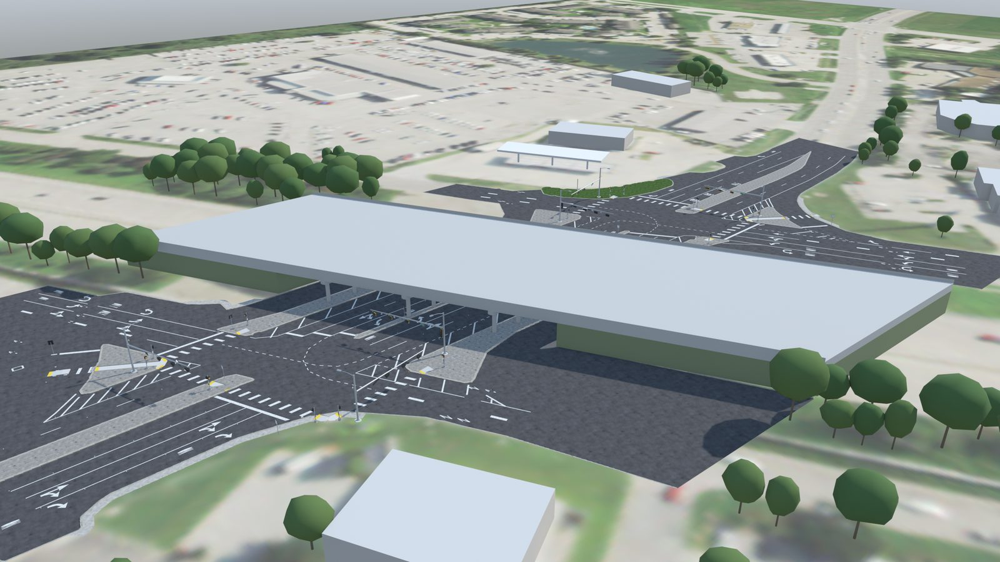
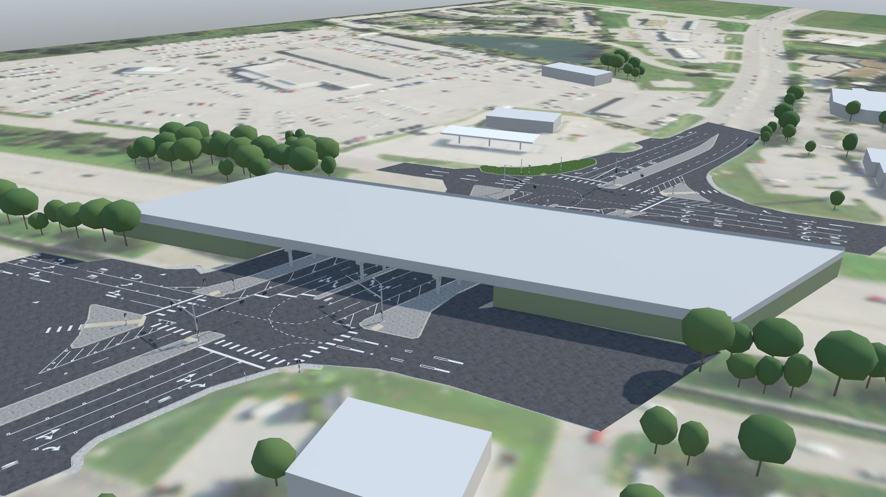
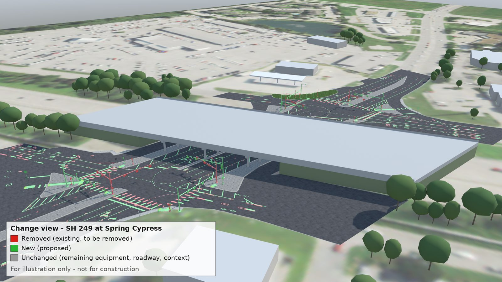
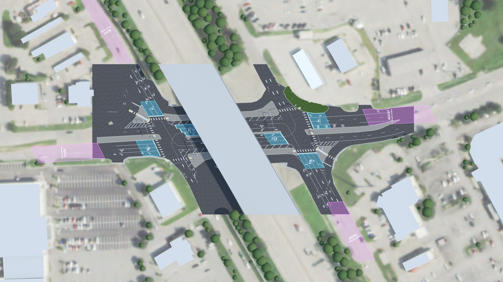
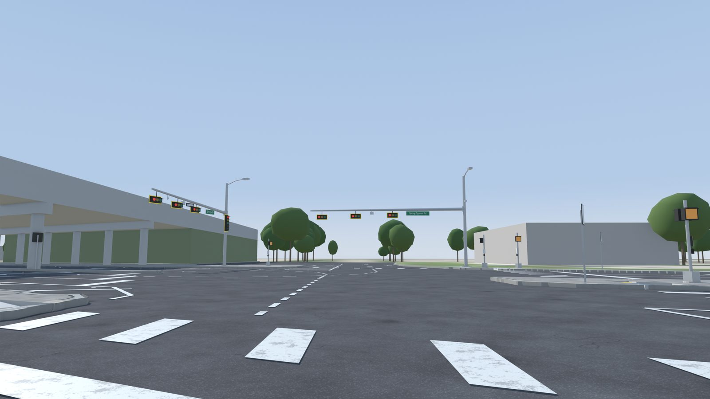
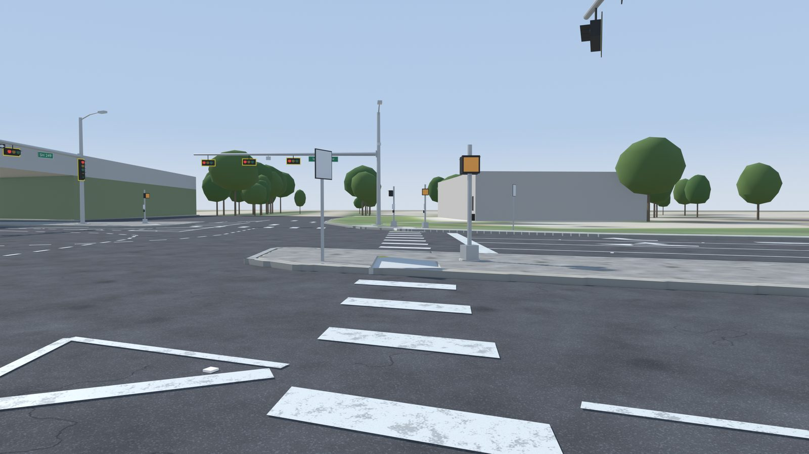
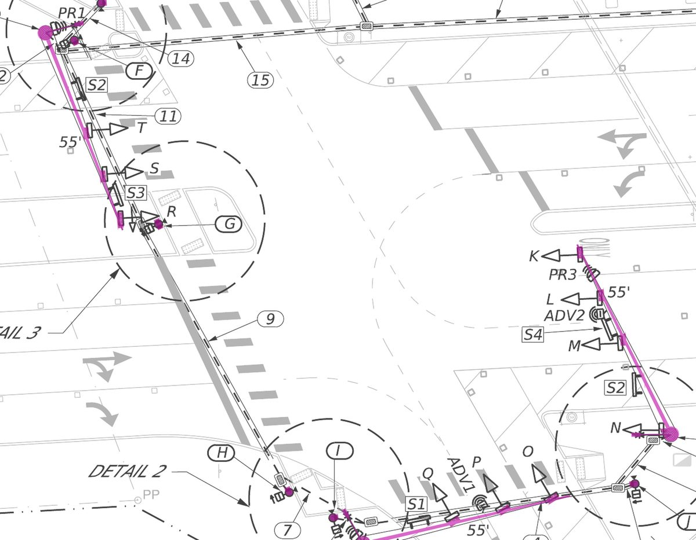

# SH 249 at Spring Cypress Rd: a traffic signal upgrade in 3D

A 3D model of a real TxDOT traffic signal project, built from the construction plan sheets. It shows the **existing** signals and the **proposed** ones on top of an aerial photo of the site. **SH 249 at Spring Cypress Rd** in Harris County, Texas (CSJ 0720-03-153) is a diamond interchange, so there are two signalized intersections: the southbound frontage road and the northbound frontage road.

**[▶ Open the interactive 3D viewer](https://fraxinus1098.github.io/blender-traffic-intersection/)** (runs in the browser, about 9 MB, no install)



This was a fun side project to see how far you can get from plan sheets to a 3D model you can walk around in. It was built with Blender and Claude, which drove Blender through the Blender MCP connection. It's meant for learning and for showing to other civil engineers.

> **For illustration only, not for construction.** This is a visualization, not a design or a survey. Where the plans were silent, defaults were assumed, and they're all listed in [docs/ASSUMPTIONS.md](docs/ASSUMPTIONS.md).

## What's in it

- **Existing condition** (sheets 24–25, 38–39): dual and single mast arms, signal heads, pedestal ped poles, the controller, service poles, existing markings, curbs, islands and sidewalks.
- **Proposed condition** (sheets 26–28, 40–41, 67): six new mast arms (55′/60′) with luminaires and street-name signs, 3-, 4- and 5-section heads at 17′-6″, radar presence and advance detection, APS ped poles, the new controller with battery backup, the new electrical service, new crosswalks, stop bars, lane lines and arrows, and Type 1/5/21/22 curb ramps with detectable warnings.
- **Context:** the SH 249 mainlane bridge, OSM building massing, about 130 trees detected from the aerial, and the NAIP 2022 aerial as the ground.
- **Engineering extras:**
  - a red/green change view (removed vs. new);
  - radar detection zones drawn from the plan schedule;
  - driver's-eye cameras at every stop bar, with a signal-head visibility check against MUTCD 4D;
  - pedestrian views from each new curb ramp.

| Existing | Proposed |
|---|---|
|  |  |

| Change view (red = removed, green = new) | Radar detection zones |
|---|---|
|  |  |

| Driver's eye, SB feeder at 50 mph | Pedestrian view, crossing the median |
|---|---|
|  |  |

## Try it

| File | What it is | How to open |
|---|---|---|
| [Web viewer](https://fraxinus1098.github.io/blender-traffic-intersection/) / `export/sh249_springcypress_viewer.html` | One self-contained HTML file. Switch between Existing, Proposed, Both and Change; toggle layers (incl. radar zones); jump to 22 camera presets; click any object to see its plan callout and notes. | Click the link, or download the HTML and double-click it (works offline). |
| `export/sh249_springcypress.kmz` | Signals, signs, markings and ramps placed on the real site. | Google Earth Pro → File → Open. Turn off the 3D Buildings layer if it hides the markings. |
| `export/sh249_springcypress.glb` | The full model as glTF (6 MB), with the plan notes as `extras` on each object. | Any glTF viewer, e.g. [gltf-viewer.donmccurdy.com](https://gltf-viewer.donmccurdy.com/), or import into Blender. |
| `blend/sh249_sc_v09.blend` | The clean Blender model. | Blender 5.2 or newer. Open it from inside the cloned repo so the textures and aerial load. |
| `export/final_*.png` | Six 2400 × 1350 renders. | |

The [Releases](https://github.com/fraxinus1098/blender-traffic-intersection/releases) page has the viewer, KMZ and GLB as plain downloads.

## How it was built

The build went in phases, each checked against the plans before moving on:

| Phase | What happened |
|---|---|
| 0–1 | Blender set up at true scale (feet). The vector PDF sheets were registered to each other using the 0–40′ scale bar and the match lines. |
| 2 | The NAIP aerial was imported and the plans aligned to it. The plans turned out to be drawn on **Texas State Plane grid north**, rotated about 2.97° from the UTM aerial, and fitting against vegetation edges found that rotation independently. Alignment is good to about 1 m. |
| 3 | Pavement, curbs, islands and existing markings were built straight from the PDF vector linework (pdfplumber → raster classification → triangulated meshes). |
| 4–5 | Existing and proposed signal equipment was placed from the plan symbols and checked by overlaying a top-down render on the sheet (everything lands within about 1 ft). Proposed markings and curb ramps were added, with the ramps cut into the curb. |
| 6 | Context and look: OSM buildings, trees detected from the aerial, generated textures, sun position for a mid-April morning. |
| 7 | Change view, radar zones, driver and pedestrian cameras, and the head-visibility check (result: every head is visible from every lane, within the MUTCD cone and distance limits). |
| 8 | Export: GLB, the three.js viewer, the KMZ and the final renders. |

Plan screenshot overlays like this one were the main accuracy check:



More detail:
- [docs/BUILD_LOG.md](docs/BUILD_LOG.md): the full phase-by-phase record (callout tables, symbol conventions, coordinate frames, decisions)
- [docs/ASSUMPTIONS.md](docs/ASSUMPTIONS.md): all 73 assumptions
- [docs/BUILD.md](docs/BUILD.md): how to rerun the scripts and rebuild the exports
- [docs/PROJECT_BRIEF.md](docs/PROJECT_BRIEF.md): the original brief and key facts from the plans
- [docs/CLAUDE_WORKFLOW.md](docs/CLAUDE_WORKFLOW.md): how the Claude + Blender MCP workflow ran, and what broke along the way

## Repo layout

```
blend/     sh249_sc_v09.blend (clean model), sh249_sc_v10_export.blend (export copy)
export/    viewer HTML, GLB, KMZ, final renders
plans/     TxDOT plan sheets: the PDF extract (sheets 23–45, 67–68) and 300-dpi PNGs of the Spring Cypress sheets
imagery/   NAIP 2022 aerial GeoTIFF (0.6 m, UTM 15N)
work/      every build script (p2_… to p8_…), the intermediate data they produce, textures, viewer source
docs/      build log, assumptions, brief, images
```

The `.blend` files look for `work/tex/`, `imagery/` and `plans/masked/` relative to themselves, so keep the folder structure as it is.

## Known limits

- The site is modeled flat: the plans give no profiles.
- Sign faces without a legend in the plans (R10-3e, R3-8, existing street-name signs) are blank.
- Building heights are guessed by building type; trees are approximate.
- The frontage roads may actually be concrete, not asphalt.
- Underground items (conduit, bores, ground boxes) are not modeled.

## Credits and sources

See [ATTRIBUTION.md](ATTRIBUTION.md). Short version:
- plans from TxDOT (public bid documents);
- aerial from USDA NAIP via TxGIO;
- buildings © OpenStreetMap contributors (ODbL);
- the viewer uses three.js (MIT);
- Blender with the [BlenderGIS](https://github.com/domlysz/BlenderGIS) add-on.

The code in this repo is MIT-licensed ([LICENSE](LICENSE)); the data keeps its own terms.
