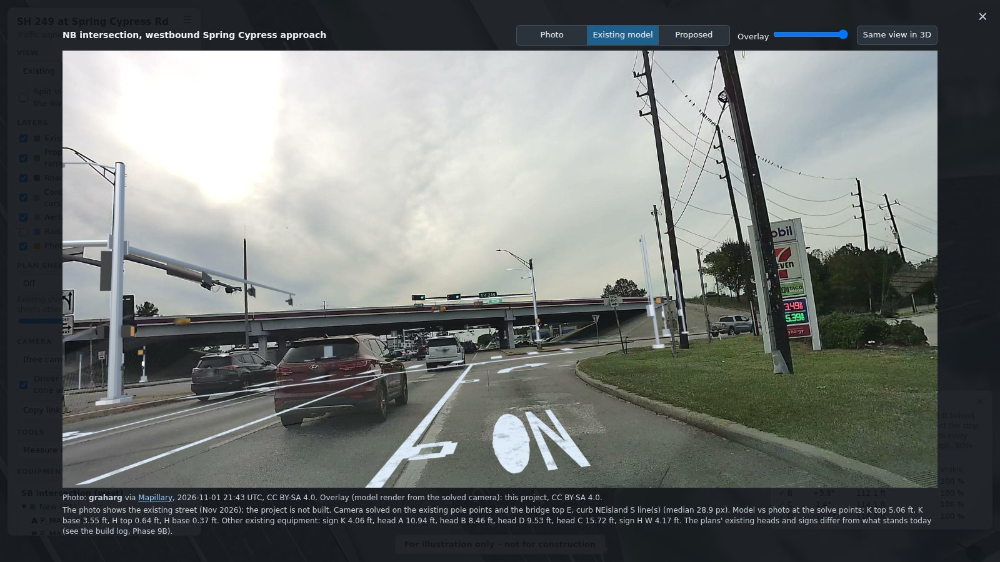
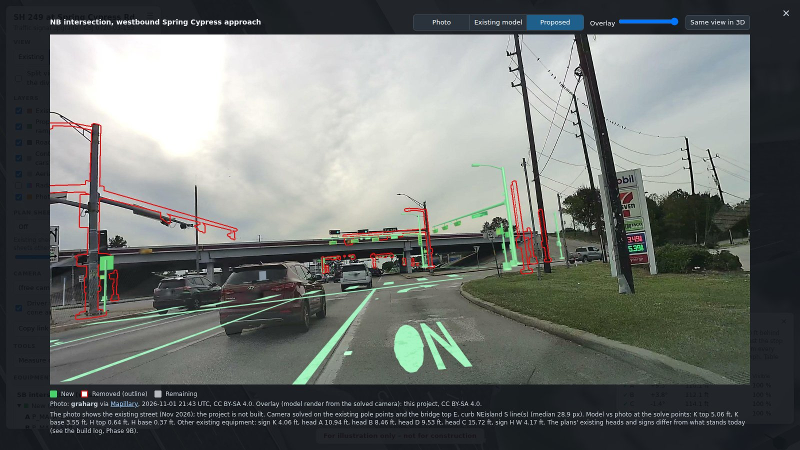
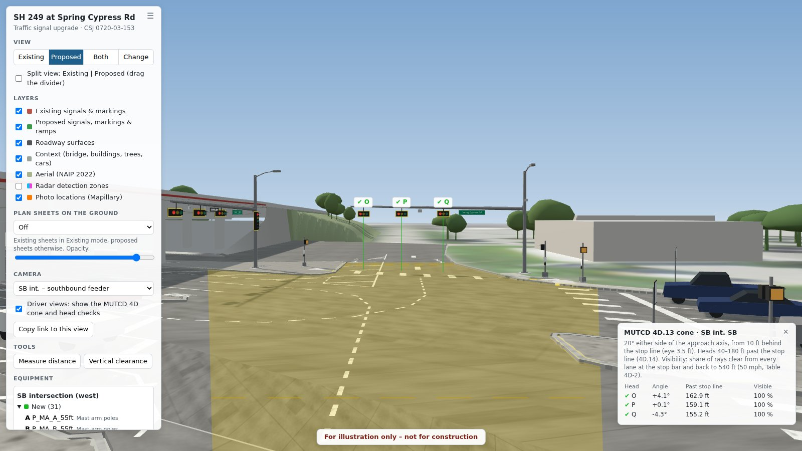
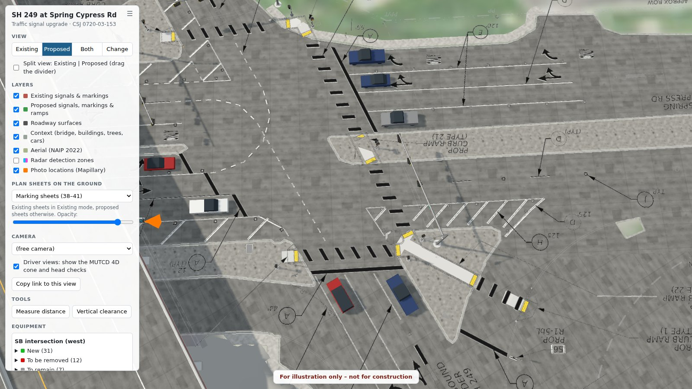

# SH 249 at Spring Cypress Rd: a traffic signal upgrade in 3D

A 3D model of a real TxDOT traffic signal project, built from the construction plan sheets. It shows the **existing** signals and the **proposed** ones on top of an aerial photo of the site. **SH 249 at Spring Cypress Rd** in Harris County, Texas (CSJ 0720-03-153) is a diamond interchange, so there are two signalized intersections: the southbound frontage road and the northbound frontage road.

**[▶ Open the interactive 3D viewer](https://fraxinus1098.github.io/blender-traffic-intersection/)** (runs in the browser, about 31 MB, no install)


This was a fun side project to see how far you can get from plan sheets to a 3D model you can walk around in. It was built with Blender and Claude, which drove Blender through the Blender MCP connection. It's meant for learning and for showing to other civil engineers.

> **For illustration only, not for construction.** This is a visualization, not a design or a survey. Where the plans were silent, defaults were assumed, and they're all listed in [docs/ASSUMPTIONS.md](docs/ASSUMPTIONS.md).

## Street photos with the model on top

Two dashcam photos from November 2026 (Mapillary, CC BY-SA 4.0), with the camera solved on the existing poles and curbs and the model drawn over them. The project isn't built yet, so the photos show today's street.

| Existing model on the photo | Proposed (green new, red outline removed) |
|---|---|
|  |  |

The poles used to solve the camera land within 0.4–5 ft of the real ones. The existing heads and signs as drawn in the plans sit 4–16 ft from where they hang today, and the plans' existing markings only partly match the paint. Details are in [the build log](docs/BUILD_LOG.md#9b-mapillary-photo-overlays-done).

## What's in it

- **Existing condition** (sheets 24–25, 38–39): mast arms, signal heads, ped poles, the controller, service poles, markings, curbs, islands and sidewalks.
- **Proposed condition** (sheets 26–28, 40–41, 67): six new mast arms with luminaires and street-name signs, 3-, 4- and 5-section heads, radar detection, APS ped poles, the new controller and service, new markings, and curb ramps with detectable warnings.
- **Context:** the SH 249 bridge and the buildings and trees at their 2024 lidar heights, concrete pavement, a few cars for scale, and the NAIP 2022 aerial as the ground.
- **Engineering checks:** a red/green change view, radar detection zones, driver's-eye views at every stop bar with a signal-head visibility check against MUTCD 4D, and pedestrian views from each new curb ramp.
- **In the viewer:** the plan sheets draped on the ground, an Existing | Proposed split, measure and clearance tools, the MUTCD cone for each driver view, an equipment list, the street photos, and shareable links.

| Change view (red = removed, green = new) | Radar detection zones |
|---|---|
|  |  |

| Driver's eye with the MUTCD 4D cone | Plan sheets on the ground |
|---|---|
|  |  |

## Try it

| File | What it is | How to open |
|---|---|---|
| [Web viewer](https://fraxinus1098.github.io/blender-traffic-intersection/) / `export/sh249_springcypress_viewer.html` | The whole model in one self-contained HTML file, with the tools listed above. | Click the link, or download the HTML and double-click it (works offline). |
| `export/sh249_springcypress.kmz` | Signals and signs in 3D, markings draped on the terrain, a clickable pin per pole and cabinet, plan-sheet overlays and a tour. | Google Earth Pro → File → Open. Turn off 3D Buildings if it hides the markings. |
| `export/sh249_springcypress.glb` | The full model as glTF (8 MB), with the plan notes on each object. | Any glTF viewer, e.g. [gltf-viewer.donmccurdy.com](https://gltf-viewer.donmccurdy.com/). |
| `blend/sh249_sc_v11.blend` | The clean Blender model. | Blender 5.2+, opened from inside the cloned repo so the textures load. |
| `export/final_*.png` | Six 2400 × 1350 renders. | |

To keep a copy, open the file on GitHub and click **Download raw file** (↓) at the top right.

## How it was built

The vector PDF sheets were registered at true scale and aligned to the aerial (the plans are on Texas State Plane grid north, about 2.97° from UTM; alignment is good to about 1 m). Pavement, curbs and markings came straight from the PDF linework, and the signal equipment was placed from the plan symbols. Each step was checked by overlaying a top-down render on the sheet, and everything lands within about 1 ft. A later pass added lidar heights, the street-photo overlays and the viewer tools.


More detail:

- [docs/BUILD_LOG.md](docs/BUILD_LOG.md): the phase-by-phase record (Phases 0–9)
- [docs/ASSUMPTIONS.md](docs/ASSUMPTIONS.md): all 86 assumptions
- [docs/BUILD.md](docs/BUILD.md): how to rerun the scripts and rebuild the exports
- [docs/PROJECT_BRIEF.md](docs/PROJECT_BRIEF.md), [docs/PLAN_v11.md](docs/PLAN_v11.md): the original brief and the Phase 9 plan
- [docs/CLAUDE_WORKFLOW.md](docs/CLAUDE_WORKFLOW.md): how the Claude + Blender MCP workflow ran

## Repo layout

```
blend/     sh249_sc_v11.blend (clean model), sh249_sc_v12_export.blend (export copy), sh249_sc_v09.blend (Phase 7)
export/    viewer HTML, GLB, KMZ, final renders
plans/     TxDOT plan sheets: PDF extract and 300-dpi PNGs of the Spring Cypress sheets
imagery/   NAIP 2022 aerial GeoTIFF (0.6 m, UTM 15N)
work/      build scripts (p2_… to p9_…), their intermediate data, textures, viewer source, photo overlays
docs/      build log, assumptions, brief, images
```

The `.blend` files load `work/tex/`, `imagery/` and `plans/masked/` by relative path, so keep the folder structure as it is.

## Known limits

- The site is flat: the plans give no profiles.
- The existing equipment is placed from the plan symbols, not surveyed; the street photos show existing heads and signs 4–16 ft from those positions.
- The bridge details, building shapes and tree crowns are illustrative; their heights are measured.
- Sign faces with no legend in the plans (R10-3e, R3-8) are blank.
- The concrete joint pattern is a generic 15 × 12 ft grid.
- Underground items (conduit, bores, ground boxes) are not modeled.

## Credits and sources

See [ATTRIBUTION.md](ATTRIBUTION.md). In short: plans from TxDOT (public bid documents); aerial from USDA NAIP via TxGIO; buildings © OpenStreetMap contributors (ODbL); lidar from the USGS 3D Elevation Program (public domain); street photos by Mapillary user graharg (CC BY-SA 4.0, and so are the overlays made from them); the viewer uses three.js (MIT); Blender with the [BlenderGIS](https://github.com/domlysz/BlenderGIS) add-on.

The code in this repo is MIT-licensed ([LICENSE](LICENSE)); the data keeps its own terms.
